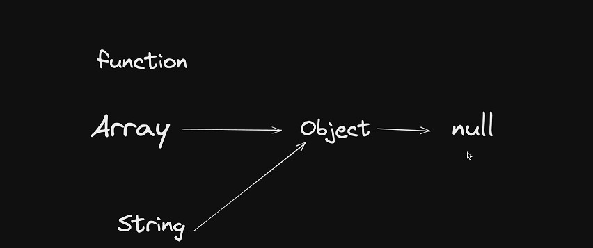

## Prototype



### Prototype is the reason inheritance exist in javascript.

#### In JavaScript, almost everything—including Arrays and Functions—is actually a specialized type of Object under the hood, so they all sit in one big family tree connected by prototypes.

```diagram
                [ null ]
                   ▲
                   │
          [ Object.prototype ]   <-- The Grandparent (has .toString(), .hasOwnProperty(), etc.)
             ▲            ▲
             │            │
   [ Array.prototype ]  [ Function.prototype ]  <-- Parents (add specific tools)
      (adds .push,         (adds .call, .bind,
       .map, .filter)       .apply)
             ▲                    ▲
             │                    │
       myArray = [1, 2]     function myFunc() {}  <-- Your variables

```